# Direct USB mount (v2)

> **Scope**: the `direct_mount` feature — a DomU mounts `/media/usb` directly from `sys-usb` over a vchan SFTP channel (sshfs).
>
> **Last updated**: 2026-11-22
>
> **Main artifacts**: `SysUsbController` + the `safecor_direct_mount` component (`_sys_usb_controller.py`, sys-usb), the `safecor-dm-channels.py` root helper (sys-usb), `DirectMountManager` (`_direct_mount_manager.py`, DomU), the `sftp` vchan channel, `sshfs`.

## What it is

A DomU with a `direct_mount` entry in its [topology](../../specifications/topology.md) mounts the USB storage **directly** from `sys-usb`, bypassing the file API:

```json
"direct_mount": { "mode": "rw" }
```

- `mode` — `"ro"` for read-only access, `"rw"` for read-write. Default is `"rw"`.
- The mount point is `/media/usb` in the domain; the application sees the same tree as `sys-usb` (`/media/usb/<label>`).

## The chain

```
application (DomU) opens files under /media/usb
  → sshfs (mounted /media/usb, ssh_command = the vchan-sftp script)
  → vchan-socket-proxy, client mode, stdio
      -m client <sys-usb domid> /local/domain/system/vchan/<domain>/sftp -
  → vchan "sftp" PV channel (ring in xenstore /local/domain/system/vchan/<domain>/sftp)
  → vchan-socket-proxy, server mode (sys-usb, one per authorized domain, started by the SysUsbController through the safecor-dm-channels.py doas helper)
  → socat (UNIX-LISTEN /var/run/safecor/direct-mount/vchan-<domain>.sock, fork)
  → bubblewrap (per session: private tmpfs root, /media/usb bound at the same path and made the working directory, sftp-server + setpriv + its libraries + minimal /etc/passwd + musl loader read-only, fresh /dev, unshared pid/ipc/uts/net namespaces)
  → openssh sftp-server (read-only on ro channels, request filters, umask)
```

**Security constraints on the server side**: the `sftp-server` runs in a **per-session bubblewrap sandbox** (`bwrap`, spawned by socat for every connection — no boot-time assembly). The sandbox root is a **private tmpfs** that exists only for the duration of the session: nothing it creates ever reaches the host filesystem or the client's sshfs view. `/media/usb` is bound at the same path (read-only for the `ro` channels) and made the working directory, so the served SFTP root is exactly the USB mount tree. The `sftp-server` binary, the `setpriv` helper (its path is resolved with `shutil.which` at start — it moves across Alpine releases) and the shared libraries `setpriv` needs (resolved with `ldd` at start, so the bind list stays correct across util-linux versions), a **minimal one-account `/etc/passwd`** (written at start, providing only the account the server runs as — `sftp-server` 10+ refuses to start if its own uid is not in `/etc/passwd`), and the musl dynamic loader are bound in read-only; a fresh `/dev` is mounted and the pid/ipc/uts/net namespaces are unshared. The `sftp-server` runs as the dedicated `svc-sys-usb-sftp` service account with no capabilities: `setpriv` (bound in read-only) drops to the account inside the sandbox before exec, and only `CAP_SETUID`, `CAP_SETGID` and `CAP_SETPCAP` remain in the bounding set for the short-lived root switch — the disks are owned by the account (mdev mount options), so no DAC override is needed. `bwrap` pivots twice into the new root and detaches the old one, so the host root filesystem is unreachable from the sandbox (unlike a plain chroot, which a root process can escape). The `sftp-server` is read-only when the channel mode is `ro`, applies request filters and a restrictive umask, and only the domains listed in the topology are authorized (one server per authorized domain).

When a USB disk is added, removed or changed, the mdev hook (`mdev-usb-storage.sh`) kills the existing sftp sessions: each session's sandbox is a mount-table snapshot taken at spawn, so the clients' sshfs (with the `reconnect` option) must reconnect to pick up the new mount state.

## The `safecor_direct_mount` component (the single synchronization point)

The readiness of the SFTP side is published as the state of the **`safecor_direct_mount`** component, on `system/discover/components`, by the `SysUsbController` (sys-usb). It is the **single synchronization point** of the feature (NFR-3): the consumers react to its notification, they never poll.

| State | Meaning |
|-------|---------|
| `STARTING` | boot: the SFTP channels are not up yet (domid resolution, channel start, liveness verification), or the one-shot `my_config` query timed out, or the start pass failed (domid timeout, helper error, liveness verification failure — an `error` event names the failed domains and the local log records it). The component does **no retry** itself: recover with `rc-service safecor-sys-usb-controller restart`. Visible in the diagnostics as the SFTP side being broken while the disks are fine. |
| `READY` | every `direct_mount` SFTP channel is started **and verified alive** (pidfiles + UNIX socket, ~1 s settle after the helper), **or** there is zero `direct_mount` domain. |
| `OFF` | sys-usb is shutting down or restarting: the consumers unmount. |

The controller resolves the topology with a **one-shot `my_config` query** (a bounded wait in a dedicated thread, NFR-1), resolves each domain's domid with a **bounded wait** (polling every 1 s, 60 s timeout per domain — blocking is allowed in the dedicated channel thread, NFR-1), starts/stops the per-domain channels through the **`safecor-dm-channels.py`** root helper (run via `doas`, the only privilege elevation — the per-session sandbox needs a root parent to drop to the `svc-sys-usb-sftp` account), and **verifies each started channel is alive** (pidfiles + UNIX socket) before publishing `READY` — a start failure keeps the component `STARTING` (issue #270). Every channel-lifecycle event is appended to the local persistent log `/var/log/safecor/direct-mount.log` (created by the controller initd, owned by `svc-sys-usb-controller`), complementing the ephemeral MQTT `Logger`.

The controller user (`svc-sys-usb-controller`, non-root since the #253 refactor) needs read access to `/dev/xen/xenbus` (the xenstore device, root-only by default) to resolve DomU domids and manage vchan channels. The controller initd grants this at boot by changing the device group to `safecor` and setting `chmod 640`; if the read-only permission does not suffice, it falls back to `660` (issue #271).

### socat EXEC address limit (issue #272)

socat's address parser stores each address parameter in a fixed 512-byte buffer. The full `bwrap` command for one sftp-server session is ≈780 bytes (≈781 bytes on Alpine 3.24); passing it inline as the EXEC address causes socat to reject it at parse time with `address "…" too long`. Because socat's log buffer is itself ≈512 bytes, the rejection reason is truncated and never appears in the logs — the symptom is that every `sshfs` mount on a business DomU hangs on any I/O.

The fix uses a **per-domain wrapper script** (`/usr/lib/safecor/tmp/sandbox-<domain>`): the root channels helper (`safecor-dm-channels.py`) writes a single-`exec` script with shlex-quoted arguments at channel start, and the socat EXEC address is reduced to ≈50 bytes (the wrapper path). The wrapper is removed at channel stop. The directory is created `root:safecor` with mode 770 by the controller initd at boot (matching the Dom0 convention of group-accessible paths), and stale wrappers from a previous boot are cleaned up. The `bwrap` path is resolved once at start (like `setpriv`) and stored in the `SandboxContext`.

## `DirectMountManager` (DomU side)

Runs as a standalone process in the DomU. **Event-driven (NFR-3)** — it keeps a persistent MQTT client for the whole process life and reacts to the bus instead of polling:

1. At subscribe time it issues the two one-shot requests allowed by NFR-3: a `my_config` query (the domain's mount mode) and a `discover_components` request (the component states).
2. The one-shot `my_config` answer determines the mode: `RO`/`RW` ⇒ enabled, `False` (not enabled) ⇒ the process logs and **exits cleanly**.
3. On every `safecor_direct_mount` notification it updates the component state (a state update only — NFR-1) and wakes a worker thread:
   - `READY` + mode known + not mounted ⇒ generate the `vchan-sftp` script and mount `/media/usb` with sshfs (read-only option when the mode is `ro`), then start a watchdog thread blocked on the sshfs process.
   - `OFF` ⇒ unmount.
   - `STARTING` ⇒ nothing (the mount waits for `READY`).
4. The **watchdog** is blocked on the sshfs process (an event, not a poll): when sshfs dies it remounts, unless the process is stopping or the component is `OFF`.

The mount is **proactive at the end of the domain startup and kept permanent**, whether or not a USB disk is connected (the sshfs mount of `sys-usb`'s `/media/usb` directory succeeds even when empty). Product applications use `System.is_usb_mountpoint_ready()` / `System.on_usb_mountpoint_ready()` rather than the manager directly.

## Low Level Design (SFTP + inputs channels)

```mermaid
flowchart LR

    %% ---------------- Authorized domain (SFTP client) ----------------
    subgraph BUS["Authorized business/GUI domain — direct USB mount"]
        direction TB
        APP["Product application<br/>access to the USB disk files"]
        SSHFS["sshfs, mounted /media/usb<br/>ssh_command = vchan-sftp script<br/>read-only option for ro channels"]
        VCC["vchan-socket-proxy, client mode, stdio<br/>-m client &lt;sys-usb domid&gt; /local/domain/system/vchan/&lt;domain&gt;/sftp -"]
        APP -->|open files| SSHFS
        SSHFS -->|spawn| VCC
    end

    %% ---------------- sys-usb (SFTP server + input/tty clients) ----------------
    subgraph SYSUSB["sys-usb — USB controller domain, trust low"]
        direction TB
        USBST["USB storage devices<br/>mounted /media/usb/&lt;label&gt;"]
        SFTPS["vchan-socket-proxy, server mode<br/>one per authorized domain, sftp channel<br/>started by the SysUsbController (safecor_direct_mount)"]
        SOCAT["socat<br/>UNIX-LISTEN /var/run/safecor/direct-mount/vchan-&lt;domain&gt;.sock, fork<br/>spawns the sftp-server per connection"]
        SFTP["openssh sftp-server<br/>bwrap sandbox (root /media/usb)<br/>read-only, request filters, umask"]
        INPD["sys-usb controller<br/>inputs daemon, evdev<br/>keyboard, mouse, touch"]
        VCIN["vchan-socket-proxy, client mode<br/>input channel<br/>socket /var/run/safecor/input.sock"]
        VCTY["vchan-socket-proxy, client mode<br/>tty channel, debug mode only"]
        USBST -->|"sandbox root (bind /media/usb)"| SFTP
        SFTPS -->|UNIX socket| SOCAT
        SOCAT -->|spawn, bwrap sandbox| SFTP
        INPD -->|UNIX socket input.sock| VCIN
    end

    %% ---------------- Dom0 (input/tty servers) ----------------
    subgraph DOM0["Dom0"]
        direction TB
        VCS["vchan-socket-proxy servers<br/>input and tty channels, per domain<br/>started by create-vchan-tunnels.py"]
        ORCH["Safecor orchestrator<br/>virtual keyboard, mouse, touch"]
        TTYD["debug tty terminal<br/>debug mode only"]
        GUIAPP["GUI domain application<br/>receives the virtual inputs"]
        VCS -->|input.sock| ORCH
        VCS -->|tty.sock| TTYD
        ORCH -->|virtual inputs| GUIAPP
    end

    %% ---------------- The vchan hops ----------------
    VCC <-->|PV channel sftp<br/>ring in xenstore /local/domain/system/vchan/&lt;domain&gt;/sftp| SFTPS
    VCIN <-->|PV channel input<br/>ring in xenstore /local/domain/system/vchan/&lt;domain&gt;/input| VCS
    VCTY <-->|PV channel tty, debug mode only| VCS

    %% ---------------- Styling (Safecor palette) ----------------
    classDef dom0svc fill:#e8f1fa,stroke:#1f5e97,color:#0b1f4d
    classDef domusvc fill:#e8f1fa,stroke:#3399d9,color:#0b1f4d
    classDef ext fill:#fdf3cf,stroke:#E0CA3C,color:#0b1f4d
    class VCS,ORCH,TTYD,GUIAPP dom0svc
    class APP,SSHFS,VCC,SFTPS,SOCAT,SFTP,INPD,VCIN,VCTY domusvc
    class USBST ext
    style BUS fill:#f5f8fc,stroke:#3399d9,stroke-width:2px,color:#001c6c
    style SYSUSB fill:#fdfdfd,stroke:#9C0D38,stroke-width:2px,color:#001c6c
    style DOM0 fill:#f5f8fc,stroke:#001c6c,stroke-width:2px,color:#001c6c
```



Diagram source: [`../../diagrams/lld-sftp-inputs.mmd`](../../diagrams/lld-sftp-inputs.mmd).

## Related

- [sys-usb-controller.md](sys-usb-controller.md) — the server side context
- [vchan-tunnel-manager.md](vchan-tunnel-manager.md) — the sftp channel in the vchan model
- [../../development/protocol.md](../../development/protocol.md) — `system/topology/my_config`, used by `DirectMountManager`
