# Direct USB mount (v2)

> **Scope**: the `direct_mount` feature — a DomU mounts `/media/usb` directly from `sys-usb` over a vchan SFTP channel (sshfs).
>
> **Last updated**: 2026-11-20
>
> **Main artifacts**: `DirectMountManager` (`_direct_mount_manager.py`, DomU), `safecor-vchan-sftp.py` (sys-usb), the `sftp` vchan channel, `sshfs`.

## What it is

A DomU with a `direct_mount` entry in its [topology](../../specifications/topology.md) mounts the USB storage **directly** from `sys-usb`, bypassing the file API:

```json
"direct_mount": { "mode": "rw" }
```

- `mode` — `"ro"` for read-only access, `"rw"` for read-write. Default is `"rw"`.
- The mount point is `/media/usb` in the domain; the application sees the same tree as `sys-usb` (`/media/usb/<label>`).

## The chain

```
application (DomU) opens files under /media/usb
  → sshfs (mounted /media/usb, ssh_command = the vchan-sftp script)
  → vchan-socket-proxy, client mode, stdio
      -m client <sys-usb domid> /local/domain/system/vchan/<domain>/sftp -
  → vchan "sftp" PV channel (ring in xenstore /local/domain/system/vchan/<domain>/sftp)
  → vchan-socket-proxy, server mode (sys-usb, one per authorized domain, started by safecor-vchan-sftp.py)
  → socat (UNIX-LISTEN /var/run/safecor/vchan-<domain>.sock, fork)
  → openssh sftp-server (chroot /media/usb, read-only on ro channels, request filters, umask)
```

**Security constraints on the server side**: the `sftp-server` runs chrooted in `/media/usb`, is read-only when the channel mode is `ro`, applies request filters and a restrictive umask, and only the domains listed in the topology are authorized (one server per authorized domain).

## `DirectMountManager` (DomU side)

Runs as a standalone process in the DomU. Full flow:

1. Query the topology (`system/topology/my_config`) to check that `direct_mount` is enabled for this domain.
2. Discover the `sys-usb` domid (xenstore `domids/sys-usb`).
3. Generate the `vchan-sftp` script (the `ssh_command` of sshfs).
4. Mount `/media/usb` with sshfs (read-only option when the mode is `ro`).

## Low Level Design (SFTP + inputs channels)

```mermaid
flowchart LR

    %% ---------------- Authorized domain (SFTP client) ----------------
    subgraph BUS["Authorized business/GUI domain — direct USB mount"]
        direction TB
        APP["Product application<br/>access to the USB disk files"]
        SSHFS["sshfs, mounted /media/usb<br/>ssh_command = vchan-sftp script<br/>read-only option for ro channels"]
        VCC["vchan-socket-proxy, client mode, stdio<br/>-m client &lt;sys-usb domid&gt; /local/domain/system/vchan/&lt;domain&gt;/sftp -"]
        APP -->|open files| SSHFS
        SSHFS -->|spawn| VCC
    end

    %% ---------------- sys-usb (SFTP server + input/tty clients) ----------------
    subgraph SYSUSB["sys-usb — USB controller domain, trust low"]
        direction TB
        USBST["USB storage devices<br/>mounted /media/usb/&lt;label&gt;"]
        SFTPS["vchan-socket-proxy, server mode<br/>one per authorized domain, sftp channel<br/>started by safecor-vchan-sftp.py"]
        SOCAT["socat<br/>UNIX-LISTEN /var/run/safecor/vchan-&lt;domain&gt;.sock, fork<br/>spawns the sftp-server per connection"]
        SFTP["openssh sftp-server<br/>chroot /media/usb<br/>read-only, request filters, umask"]
        INPD["sys-usb controller<br/>inputs daemon, evdev<br/>keyboard, mouse, touch"]
        VCIN["vchan-socket-proxy, client mode<br/>input channel<br/>socket /var/run/safecor/input.sock"]
        VCTY["vchan-socket-proxy, client mode<br/>tty channel, debug mode only"]
        USBST -->|root of the chroot| SFTP
        SFTPS -->|UNIX socket| SOCAT
        SOCAT -->|spawn, chroot| SFTP
        INPD -->|UNIX socket input.sock| VCIN
    end

    %% ---------------- Dom0 (input/tty servers) ----------------
    subgraph DOM0["Dom0"]
        direction TB
        VCS["vchan-socket-proxy servers<br/>input and tty channels, per domain<br/>started by create-vchan-tunnels.py"]
        ORCH["Safecor orchestrator<br/>virtual keyboard, mouse, touch"]
        TTYD["debug tty terminal<br/>debug mode only"]
        GUIAPP["GUI domain application<br/>receives the virtual inputs"]
        VCS -->|input.sock| ORCH
        VCS -->|tty.sock| TTYD
        ORCH -->|virtual inputs| GUIAPP
    end

    %% ---------------- The vchan hops ----------------
    VCC <-->|PV channel sftp<br/>ring in xenstore /local/domain/system/vchan/&lt;domain&gt;/sftp| SFTPS
    VCIN <-->|PV channel input<br/>ring in xenstore /local/domain/system/vchan/&lt;domain&gt;/input| VCS
    VCTY <-->|PV channel tty, debug mode only| VCS

    %% ---------------- Styling (Safecor palette) ----------------
    classDef dom0svc fill:#e8f1fa,stroke:#1f5e97,color:#0b1f4d
    classDef domusvc fill:#e8f1fa,stroke:#3399d9,color:#0b1f4d
    classDef ext fill:#fdf3cf,stroke:#E0CA3C,color:#0b1f4d
    class VCS,ORCH,TTYD,GUIAPP dom0svc
    class APP,SSHFS,VCC,SFTPS,SOCAT,SFTP,INPD,VCIN,VCTY domusvc
    class USBST ext
    style BUS fill:#f5f8fc,stroke:#3399d9,stroke-width:2px,color:#001c6c
    style SYSUSB fill:#fdfdfd,stroke:#9C0D38,stroke-width:2px,color:#001c6c
    style DOM0 fill:#f5f8fc,stroke:#001c6c,stroke-width:2px,color:#001c6c
```



Diagram source: [`../../diagrams/lld-sftp-inputs.mmd`](../../diagrams/lld-sftp-inputs.mmd).

## Related

- [sys-usb-controller.md](sys-usb-controller.md) — the server side context
- [vchan-tunnel-manager.md](vchan-tunnel-manager.md) — the sftp channel in the vchan model
- [../../development/protocol.md](../../development/protocol.md) — `system/topology/my_config`, used by `DirectMountManager`
