# Messaging

> **Scope**: the MQTT message bus — the Dom0 central broker, the per-DomU local brokers, and the vchan `msg` channel bridge.
>
> **Last updated**: 2026-11-20
>
> **Main artifacts**: the Dom0 `mosquitto` service, `generate-mosquitto-listeners.py` (install time), `setup-vchan.sh` (DomU boot), `socat`, `vchan-socket-proxy`.

`MqttClient` supports two transports (`ConnectionType`):

- **UNIX socket** — used by both Dom0 (`/tmp/mqtt-dom0.sock`) and DomU (`/var/run/safecor/mqtt.sock`).
- **TCP on localhost** — `TCP_DEBUG`, development only. **This is what the emulator uses** (all peers and the product under test connect to a local `mosquitto` on port 1883). See [../../development/testing.md](../../development/testing.md).

## The DomU side (local broker + bridge)

On a DomU, `/var/run/safecor/mqtt.sock` is the UNIX listener of the domain's **local mosquitto broker**: the domain's applications all connect to it (the broker multiplexes every local client), and a single **upstream bridge** carries the domain's traffic over the vchan `msg` channel: the bridge connects to a TCP loopback endpoint (`127.0.0.1:18860`), socat accepts the connection and spawns one `vchan-socket-proxy` client (stdio mode) per connection, which connects to the Dom0 vchan server. The loopback interface is brought up by `setup-vchan.sh` (the DomUs have no network interface by default).

Two installation guarantees make this robust:

1. `mosquitto` and `socat` are **apk dependencies** of `safecor-domu-base`, so they are installed before the package's post-install starts the local broker (the `setup-vchan.sh` 60 s wait loop is only a safety net).
2. The broker configuration is **generated at boot** by `setup-vchan.sh` in `/usr/lib/safecor/etc/mosquitto.conf` — it is not a packaged file because the upstream bridge name embeds the domain name (`safecor-<domain>-bridge`). See [../decisions/0003-broker-config-generated-at-boot.md](../decisions/0003-broker-config-generated-at-boot.md).

## The Dom0 side (central bus)

`create-vchan-tunnels.py` runs `vchan-socket-proxy` **servers** that connect directly to the Mosquitto broker UNIX listeners, named after the domain (`/tmp/mqtt-<domain name>.sock`) and generated from the product topology at install time (`generate-mosquitto-listeners.py`), along with the static `/tmp/mqtt-local.sock` (debug) and `/tmp/mqtt-dom0.sock` (Dom0) listeners. A TCP 1883 listener exists in debug mode only.

## Low Level Design (the `msg` channel end-to-end)

```mermaid
flowchart LR

    %% ---------------- DomU side (local broker + bridge) ----------------
    subgraph DOMU["DomU — local broker, msg channel"]
        direction TB
        A1["Component A<br/>e.g. core controller"]
        A2["Component B<br/>e.g. direct-mount manager"]
        A3["Component C<br/>e.g. GUI application"]
        LB["Local Mosquitto broker<br/>user mosquitto, conf /usr/lib/safecor/etc/mosquitto.conf<br/>UNIX listener /var/run/safecor/mqtt.sock<br/>every local client multiplexed"]
        BRG["Upstream bridge<br/>connection safecor-&lt;domain&gt;-bridge<br/>address 127.0.0.1:18860<br/>topic # both 0"]
        SOCAT["socat<br/>TCP-LISTEN:18860, bind 127.0.0.1, fork<br/>one vchan-socket-proxy per connection"]
        VCP["vchan-socket-proxy, stdio mode<br/>-m client 0 /local/domain/system/vchan/&lt;domain&gt;/msg -<br/>one process per bridge reconnection"]
        LO["loopback interface lo<br/>brought up by setup-vchan.sh<br/>precondition of the TCP loopback hop"]
        A1 -->|UNIX socket| LB
        A2 -->|UNIX socket| LB
        A3 -->|UNIX socket| LB
        LB --> BRG
        BRG -->|TCP 127.0.0.1:18860| SOCAT
        SOCAT -->|spawn, stdio| VCP
        SOCAT -.-> LO
    end

    %% ---------------- Dom0 side (central bus) ----------------
    subgraph DOM0["Dom0 — central message bus"]
        direction TB
        VCS["vchan-socket-proxy, server mode<br/>started by create-vchan-tunnels.py<br/>one server per domain, msg channel"]
        LB0["Dom0 Mosquitto broker<br/>UNIX listener /tmp/mqtt-&lt;domain&gt;.sock per domain<br/>+ /tmp/mqtt-dom0.sock and /tmp/mqtt-local.sock<br/>+ TCP 1883 listener, debug mode only"]
        C0["Dom0 components<br/>orchestrator, core controller, ...<br/>connect on /tmp/mqtt-dom0.sock"]
        VCS -->|UNIX socket /tmp/mqtt-&lt;domain&gt;.sock| LB0
        C0 <-->|/tmp/mqtt-dom0.sock| LB0
    end

    %% ---------------- The vchan hop ----------------
    VCP <-->|PV channel msg<br/>ring in xenstore /local/domain/system/vchan/&lt;domain&gt;/msg| VCS

    %% ---------------- Styling (Safecor palette) ----------------
    classDef dom0svc fill:#e8f1fa,stroke:#1f5e97,color:#0b1f4d
    classDef broker fill:#1f5e97,stroke:#0b1f4d,color:#fdfdfd
    classDef domusvc fill:#e8f1fa,stroke:#3399d9,color:#0b1f4d
    classDef note fill:#fdfdfd,stroke:#1f5e97,color:#0b1f4d,stroke-dasharray: 5 5
    class VCS,C0 dom0svc
    class LB0,LB broker
    class A1,A2,A3,BRG,SOCAT,VCP domusvc
    class LO note
    style DOMU fill:#f5f8fc,stroke:#3399d9,stroke-width:2px,color:#001c6c
    style DOM0 fill:#f5f8fc,stroke:#001c6c,stroke-width:2px,color:#001c6c
```

Diagram source: [`../../diagrams/lld-messaging.mmd`](../../diagrams/lld-messaging.mmd).

## Related

- [../../development/protocol.md](../../development/protocol.md) — the topics and payloads carried on the bus
- [vchan-tunnel-manager.md](vchan-tunnel-manager.md) — the Dom0 servers in detail
- [../decisions/0001-per-domu-local-mqtt-broker.md](../decisions/0001-per-domu-local-mqtt-broker.md)
