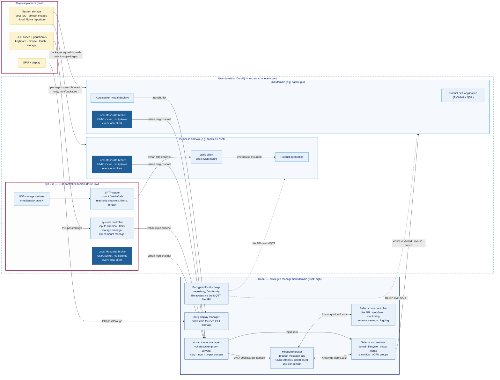

# Safecor — Architecture Overview

> **Scope**: the global description of the Safecor platform. Component details live in [components/](components/README.md); the MQTT contract lives in [../development/protocol.md](../development/protocol.md).
>
> **Last updated**: 2026-11-20

## What Safecor is

Safecor is a **software architecture for building security products** (kiosk / embedded style) on **Alpine Linux + Xen**. A product is a set of isolated virtual machines that talk to each other over **MQTT**, supervised by a privileged management domain. The same code base runs the core (on the appliance) and, through the **emulator**, on a plain development machine without Xen or real hardware.

## Actors

| Actor | Runs | Role |
|-------|------|------|
| **Dom0** (privileged) | Bare-metal / base domain | Control plane: repository, supervision, system info, workflow (shutdown / restart / GUI switch), logging. Hosts the `safecor` library's control side. |
| **Core DomU** (`sys-usb`) | Virtual machine | USB / disk / input controller: captures the USB PCI buses, lists/reads/copies/creates files on external disks and the repository, mount/unmount, and provides keyboard/mouse/touch input. |
| **Core DomU** (`sys-net`) | Virtual machine | *Not available yet* — would capture the network PCI buses (network cards) the same way `sys-usb` captures USB. |
| **Business DomU** | One VM per concern | The product's own applications (e.g. Saphir's `saphir-gui`, `saphir-av-clamav`, `saphir-av-eset`). They use the **API** to talk to the platform. |

**The fundamental rule**: domains never share memory. All cross-domain coordination is over **MQTT topics** with JSON payloads. The only in-process coupling is inside a single domain.

> **Security posture**: PCI devices are considered dangerous and are captured by dedicated DomUs (`sys-usb` for USB, `sys-net` for network) using Xen PCI passthrough — which requires IOMMU (VT-d / AMD-Vi). The video display is captured by Dom0; Domains never touch it directly. See [../security/security-model.md](../security/security-model.md).

## Deployment architecture (High Level Design)

Diagram source: [`../diagrams/hld.mmd`](../diagrams/hld.mmd); the rendered image is available in the Safecor Wiki.

## The stateless model

Each Domain is a **volatile** VM, re-created at every boot:

- The root `/` is a **tmpfs** (RAM disk) — everything is destroyed when the Domain stops.
- Optional extra disks: a **swap disk** (image created before start, destroyed on stop) and a **temporary disk** mounted on `/tmp` (`temp_disk_size`).
- Automatically attached disks: the config disk (apkovl, `xvdd`) and the local Alpine package repository on `/mnt/packages` (`xvde` squashfs image).
- **Direct USB mount** (v2, optional): a DomU with `direct_mount` in its topology entry mounts `/media/usb` directly from `sys-usb` over a vchan+sshfs channel — see [components/direct-usb-mount.md](components/direct-usb-mount.md).
- A GUI Domain (`has_gui: 1`) additionally gets a virtual keyboard, mouse and touch screen.

The platform provides **no permanent storage**: the local storage is an encrypted image created at boot and destroyed at shutdown. Business components that need persistence must use external storage (USB) through the file API or the direct USB mount.

## Data exchange (the repository)

Domains exchange **data** through the **repository**, a staging area owned by the platform:

- `Constants.STR_REPOSITORY = "__repository__"` is the virtual disk name products use.
- It lives at `/usr/lib/safecor/storage` on Dom0 and is **not mounted in the DomUs**: file access goes through the **MQTT file API** (served by the core controller — `read_file`, `copy_file`, `delete_file`, `file_fingerprint`, `create_file`) and, when enabled, the **direct USB mount**.
- A product `read_file(source, path)` stages a file into the repository and triggers a `new_file` notification (with source + destination fingerprints).
- The local Alpine repository is packed on Dom0 into a read-only `packages.squashfs` image (rebuilt at every Dom0 boot) and attached to each DomU as a plain block disk (`xvde`) mounted on `/mnt/packages`.

## Components

| Component | File |
|-----------|------|
| Orchestrator (domain lifecycle, xl configs, virtual inputs) | [components/orchestrator.md](components/orchestrator.md) |
| Messaging (Dom0 bus + DomU local broker + vchan bridge) | [components/messaging.md](components/messaging.md) |
| vchan tunnel manager (the `vchan-socket-proxy` servers) | [components/vchan-tunnel-manager.md](components/vchan-tunnel-manager.md) |
| Inputs chain (USB → sys-usb → Dom0 → GUI domain) | [components/inputs.md](components/inputs.md) |
| Display (Xorg, virtual displays, focus, splash) | [components/display.md](components/display.md) |
| Core controller (file API, workflow, logging) | [components/core-controller.md](components/core-controller.md) |
| sys-usb controller (USB storage, inputs daemon, debug TTY) | [components/sys-usb-controller.md](components/sys-usb-controller.md) |
| Direct USB mount (SFTP over vchan) | [components/direct-usb-mount.md](components/direct-usb-mount.md) |

## Related documents

- [../specifications/topology.md](../specifications/topology.md) — the `topology.json` file and its sections
- [../development/protocol.md](../development/protocol.md) — the MQTT contract (topics and payloads)
- [../development/testing.md](../development/testing.md) — the emulator and its emulatable surface
- [../project-status.md](../project-status.md) — the current status of the project
- The **Safecor Wiki** (`Safecor.wiki/`) — the public documentation for human beings
