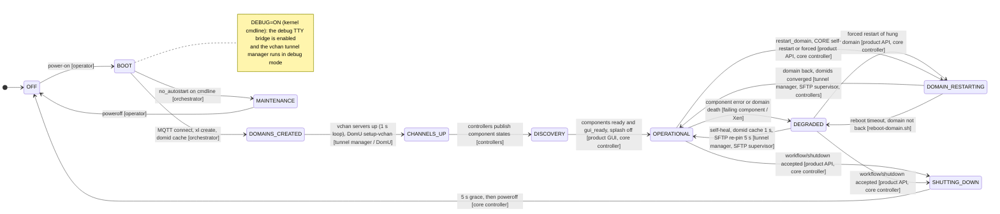

# Safecor — System Workflow

> **Scope**: the system-level workflow of the Safecor appliance — the successive states of the **system**, the transitions between them, the triggers (events) and the owner of each transition. Component internals live in [components/](components/README.md); the MQTT contract lives in [../development/protocol.md](../development/protocol.md). This document models the whole workflow so that the per-component documentation can be **coherence-checked** against a single reference.
>
> **Last updated**: 2026-11-26

## The workflow in one paragraph

The appliance boots from `OFF` into Dom0: Xen, Xenstore and the OpenRC services (Mosquitto broker, Xorg, the orchestrator, the vchan tunnel manager, the core controller) come up and the splash is shown. The **orchestrator**, once connected to the bus, creates every Domain (`xl create`) and registers each domid in the shared xenstore namespace; the **vchan tunnel manager** discovery loop (1 s) then bridges each Domain's PV channels to the Dom0 bus while every DomU's `setup-vchan` service brings up its local broker and bridge. The **controllers** connect and publish their component states; the system is `OPERATIONAL` when the expected components are `ready` and the focused GUI application publishes `system/workflow/gui_ready` (the splash is killed). In operation the system can **degrade** (component error, Domain death) and **self-heal** (domid cache write-back on the next discovery iteration, SFTP channel re-pin within 5 s — ADR 0006), **restart a single Domain** (CORE self-restart, or a forced Dom0-initiated reboot), or be **shut down** (`system/workflow/shutdown` → accepted → 5 s → `poweroff`). Domains are volatile: every boot re-creates everything from `OFF` (see [overview.md](overview.md), the stateless model).

## System states

The diagram models the **system** (the appliance), not a single component; the per-Domain mapping is in [the per-domain view](#per-domain-view). Debug mode (`DEBUG=ON` on the Dom0 kernel command line) is an orthogonal branch: it changes which Dom0 services run (the debug TTY bridge, the vchan tunnel manager's debug mode) but not the state sequence.

Diagram source: [`../diagrams/system-workflow.mmd`](../diagrams/system-workflow.mmd).

## States

| State | Entry condition | Observable signals | What the operator sees |
|-------|-----------------|--------------------|------------------------|
| `OFF` | No power, or after `poweroff`. | Nothing: no Xen, no broker, no xenstore. | Screen off. |
| `BOOT` | Dom0 up through its OpenRC runlevels. | OpenRC services running: `xenstored`, `mosquitto`, `xserver`, `orchestrator`, `create-vchan-tunnels`, `safecor-core-controller`; xenstore `/local/domain/system/screen_size` and `screen_rotation` written; the `feh` splash process up. | The boot splash. |
| `MAINTENANCE` | `no_autostart` on the Dom0 kernel command line: Dom0 is up, no DomU is created. | No `/local/domain/system/domids/*` entries; no DomU in `xl dominfo`. | The splash; no product UI. |
| `DOMAINS_CREATED` | `xl create` completed for `sys-usb` and every business Domain. | `/local/domain/system/domids/<name>` written by each start script (~1 s after `xl create`); Domains listed in `xl dominfo`; xenstore `input-focus` set to the default focus; QEMU GTK window created for GUI Domains. | Still the splash; the product UI does not answer yet. |
| `CHANNELS_UP` | Every Domain's vchan `msg` server is running and the DomU local brokers are bridged. | `/local/domain/system/vchan/<name>/<channel>/{ring-ref,event-channel}` published by the servers; `/tmp/mqtt-<domain>.sock` (Dom0 side) in use by the Dom0 broker; `/var/run/safecor/mqtt.sock` present in the DomUs. | Still the splash. |
| `DISCOVERY` | The controllers are connected to their local brokers and publish component states. | `system/discover/components` answers: `safecor_system_controller` `ready` (Dom0); `safecor_disk_controller` / `safecor_input_controller` `ready` and `safecor_direct_mount` `starting` → `ready` (`sys-usb`); the product components as published by the product. | Still the splash (until `gui_ready`). |
| `OPERATIONAL` | The expected components are `ready` and the GUI has published `system/workflow/gui_ready`. | `safecor_direct_mount` `ready` (when a `direct_mount` Domain exists); the `feh` splash process killed. | The product GUI, with working inputs and the direct USB mount (when enabled). |
| `DEGRADED` | A component is `error` or stuck `starting`, a vchan server died, or a Domain went down. | `system/events/error` entries; server restart lines in the tunnel manager's log; a component state other than `ready` on `system/discover/components`. | The product may answer partially; the USB mount or the inputs may be unavailable. |
| `DOMAIN_RESTARTING` | A restart of one Domain was accepted; the other Domains keep running. | CORE self-restart: the Domain's components published `off` on `system/discover/components/response` before its reboot. Forced: `reboot-domain.sh` running, then a **new** domid written to `/local/domain/system/domids/<name>`. | The product may be briefly degraded (e.g. USB, inputs). |
| `SHUTTING_DOWN` | A `system/workflow/shutdown` request was accepted. | `system/workflow/shutdown/response` with `accepted`; `poweroff` runs after the 5 s grace. | The product disappears; the machine powers off. |

## Transitions

The triggers are the real events from the code and the component documentation. The *owner* is the component that **executes** the transition.

| # | From → To | Trigger (event + emitter) | Owner | Side effects | Timeout |
|---|-----------|---------------------------|-------|--------------|---------|
| 1 | `OFF` → `BOOT` | Power-on (hardware, operator). | OpenRC / Xen (Dom0). | Full Dom0 boot; the per-Domain Mosquitto UNIX listeners (generated at install time) are available. | — |
| 2 | `BOOT` → `DOMAINS_CREATED` | The orchestrator is connected to the Dom0 broker (its MQTT `on_connected`), then `start-sys-usb.sh` and `start-business-domain.sh` per business Domain. | [Orchestrator](components/orchestrator.md). | Virtual input devices created; the USB PCI buses passed through to `sys-usb`; `xl create` per Domain; each start script writes `/local/domain/system/domids/<name>` (~1 s after create); `input-focus` set to the default focus. | — |
| 3 | `BOOT` → `MAINTENANCE` | `no_autostart` on the Dom0 kernel command line (checked by the orchestrator initd and by the orchestrator). | [Orchestrator](components/orchestrator.md). | No DomU is created; the Dom0 services keep running. | — |
| 4 | `DOMAINS_CREATED` → `CHANNELS_UP` | A Domain name appears in the domid cache **and** the channel's consumer socket exists (Dom0 side); each DomU runs its `setup-vchan` service (default runlevel). | [vchan tunnel manager](components/vchan-tunnel-manager.md) (Dom0 servers) + `setup-vchan.sh` (DomUs). | One `vchan-socket-proxy` server per (domid, channel) — `msg` for every Domain, `input`/`tty` additionally for `sys-usb`; the channel ring published at `/local/domain/system/vchan/<name>/<channel>`; the DomU local broker bridges all topics over `127.0.0.1:18860` → socat → vchan client. | Discovery loop: 1 s iterations. DomU waits: domid ≤ 30 s, `msg/ring-ref` ≤ 15 s (then starts "anyway"), broker socket ≤ 10 s. |
| 5 | `CHANNELS_UP` → `DISCOVERY` | The local broker socket is up and the controller processes start (OpenRC). | [Core controller](components/core-controller.md) (Dom0), [sys-usb controller](components/sys-usb-controller.md). | The controllers subscribe and answer `discover_components`; `sys-usb` starts the inputs daemon and the `safecor_direct_mount` SFTP channels (one-shot `my_config`, domid wait, liveness check) and publishes `starting` → `ready`. | `sys-usb` SFTP start: `my_config` ≤ 10 s, domid ≤ 60 s per Domain, ~1 s liveness settle. |
| 6 | `DISCOVERY` → `OPERATIONAL` | The expected components are `ready` and the focused GUI application publishes `system/workflow/gui_ready`. | The **product** (emits `gui_ready`) + the core controller (kills the splash) — see [Display](components/display.md). | The `feh` splash process is killed; the focused GUI window becomes the visible product UI. | — |
| 7 | `OPERATIONAL` → `DEGRADED` | A component publishes `error` (or stays `starting`), a vchan server exits, or a Domain dies. | The failing component / Xen. | The discovery loop reaps the dead server and restarts it on the next iteration; `system/events/error` entries. | Next discovery iteration (1 s). |
| 8 | `DEGRADED` → `OPERATIONAL` | The self-heal converges: the live domid is resolved and the domid cache written back; the SFTP channels are re-pinned; the controllers re-publish `ready`. | [vchan tunnel manager](components/vchan-tunnel-manager.md) + the SFTP channel supervisor ([ADR 0006](decisions/0006-domid-source-of-truth.md)). | Domid cache self-heal (≤ 1 s); SFTP channel re-pin (≤ 5 s supervisor tick); `safecor_direct_mount` back to `ready`; the sshfs clients reconnect (watchdog + `reconnect`). | ≤ 1 s + ≤ 5 s. |
| 9 | `OPERATIONAL` → `DOMAIN_RESTARTING` (CORE self-restart) | A `restart_domain` request with `forced=false` for a CORE Domain (from any Domain, e.g. the product GUI): the core controller answers `accepted`; the **same request** is mirrored by the bus to the Domain's own broker and the Domain reboots itself. | Core controller (accept) + the **Domain itself** (`sys-usb`: `SysUsbController.__handle_restart`). | The Domain publishes its components `off` and stops its SFTP channels, then `doas /sbin/reboot`; Dom0 tears down the old vchan servers (stale domid) and recreates them on the new domid; the SFTP supervisor re-pins the channels. | Cache self-heal ≤ 1 s; SFTP re-pin ≤ 5 s; the Domain boot time. |
| 10 | `OPERATIONAL` → `DOMAIN_RESTARTING` (forced) | A `restart_domain` request with `forced=true` (any Domain, including CORE — the escape hatch for a hung Domain). | Core controller → `reboot-domain.sh` (via `doas`). | `xl reboot`; the script waits for the Domain to go down, then for it to come back with a **new** domid, and writes the domid cache; the response is `accepted` on success, `refused` on failure. | Down ≤ 30 s, up ≤ 60 s (overridable: `DOWN_TIMEOUT`, `UP_TIMEOUT`, `POLL_INTERVAL`). |
| 11 | `DOMAIN_RESTARTING` → `OPERATIONAL` | The Domain is back and the domids have converged. | Tunnel manager + SFTP supervisor + the Domain's controllers. | The new vchan servers are up; the SFTP channels are re-pinned and verified alive; the component states re-published `ready`. | Seconds (self-restart); ≤ 90 s + boot (forced path, worst case). |
| 12 | `DOMAIN_RESTARTING` → `DEGRADED` | `reboot-domain.sh` timed out (the Domain never came back with a new domid). | Core controller (responds `refused`). | The Domain stays down; the system keeps running without it until a retry or a system reboot. | — |
| 13 | `OPERATIONAL` / `DEGRADED` → `SHUTTING_DOWN` | A `system/workflow/shutdown` request (product). | [Core controller](components/core-controller.md). | Response `accepted` (there is currently no refusal rule); a 5 s grace lets the GUIs and clients acknowledge; a re-entry guard blocks a second shutdown. | 5 s grace. |
| 14 | `SHUTTING_DOWN` → `OFF` | The grace elapsed. | Core controller → `doas /sbin/poweroff`. | Xen powers off; every DomU is destroyed; all volatile state (tmpfs rootfs, swap/temp images) is gone. | — |
| 15 | `MAINTENANCE` → `OFF` | Power-off from the Dom0 console (operator). | OpenRC / Xen. | As row 14. | — |

> The `system/workflow/shutdown` handler accepts the request from **any** live state (the guard only blocks a second shutdown while one is in progress); the diagram shows it from `OPERATIONAL` and `DEGRADED` for readability.

## Per-domain view

How each Domain maps its local lifecycle onto the system states (the internals are in the referenced component docs):

| System state | Dom0 | `sys-usb` (core DomU) | Business DomUs |
|--------------|------|----------------------|----------------|
| `BOOT` | OpenRC: `xenstored`, `mosquitto`, `xserver` (kills the fbsplash, shows the `feh` splash), `orchestrator`, `create-vchan-tunnels`, `safecor-core-controller`. | Not created yet. | Not created yet. |
| `DOMAINS_CREATED` | `xl create` per Domain (`sys-usb` first, then the business Domains in topology order); the domid cache written; the virtual inputs + PCI passthrough done. | Guest boot: PVH on the Dom0 kernel; the initramfs reads the apkovl from the config disk; the OpenRC `default` runlevel begins. | Same (GUI Domains boot HVM from the CD-ROM). |
| `CHANNELS_UP` | One vchan server per (domid, channel); the `msg` servers feed `/tmp/mqtt-<domain>.sock`. | `setup-vchan` service: local broker + bridge; the `input`/`tty` vchan clients. | `setup-vchan` service: local broker + bridge. |
| `DISCOVERY` | The core controller answers `discover_components` (its own state `ready`), the workflow, the file API, `my_config`. | The controller is connected: disk + input components `ready`; the inputs daemon running; the USB disks mounted under `/media/usb`; `safecor_direct_mount` `starting` → `ready` (SFTP channels started and verified). | The product application starts; the `direct-mount` service runs the `DirectMountManager`, which waits for `safecor_direct_mount` `ready` and then mounts `/media/usb` (sshfs). |
| `OPERATIONAL` | Serves the bus; the Xorg display manager shows the focused GUI. | Serves the file API over the disks; the SFTP channel supervisor reconciles every 5 s. | The product runs; the sshfs mount is kept alive by the watchdog. |
| `DEGRADED` | The discovery loop reaps/restarts servers; the domid cache self-heals. | A dead vchan server ⇒ its channel restarted with the live domid; a component may report `error`. | The sshfs watchdog remounts; on `safecor_direct_mount` `off` the mount is dropped. |
| `DOMAIN_RESTARTING` | Accepts the restart (CORE) or runs `reboot-domain.sh` (forced); the domid cache is rewritten. | (CORE self-restart) publishes its components `off`, stops the SFTP channels, `doas /sbin/reboot`; on the next boot it goes through the full boot cycle again. | (When the restarted Domain was a `direct_mount` peer) the channel is re-pinned by the supervisor (≤ 5 s) and sshfs reconnects. |
| `SHUTTING_DOWN` | `poweroff` after the 5 s grace. | Destroyed by Xen (no graceful stop sequence). | Destroyed by Xen (no graceful stop sequence). |

## Coherence check

> **Flagged for review — not decided.** Each item states what was found, where, why it matters, and what would need to be decided. None of these items is resolved in this document.

1. **A GUI switch does not move the input focus.** `__handle_switch_gui` (core controller) only shows/hides the QEMU GTK window via `XcbController`; it never writes xenstore `input-focus`, while `InputsProxy` re-targets the virtual inputs only on a watch of that key. *Where*: [components/display.md](components/display.md) ("`input-focus` is updated") and [components/inputs.md](components/inputs.md) ("a GUI switch moves both the display focus and the input focus") vs `_dom0_controller.py`. *Why it matters*: after a GUI switch the keyboard/mouse/touch would keep going to the previous Domain. *Decide*: code bug (the handler should write `input-focus`) or docs wrong?

2. **A GUI switch never answers.** `protocol.md` documents `system/gui/switch/response` (`accepted`/`refused`), but the handler publishes no response at all — not even when the requested Domain has no GUI. The topic is not even defined in `_topics.py` (the GUI group only defines `system/gui/switch`). *Where*: [../development/protocol.md](../development/protocol.md) vs `_dom0_controller.py` and `_topics.py`. *Why it matters*: a product cannot tell whether the switch happened. *Decide*: publish the documented response (and define the refusal semantics), or amend the protocol.

3. **The input socket path differs between docs and code — and the two sides are conflated.** The code uses `/var/run/safecor/sys-usb-input.sock` on the **Dom0** side (`create-vchan-tunnels.py`, `inputs_proxy.py`, `Constants.SYS_USB_INPUT_SOCKET_FILEPATH`); `/var/run/safecor/input.sock` is the **DomU-side** client socket (`setup-vchan.sh`). The docs present `/var/run/safecor/input.sock` as the Dom0 path, and the stale name also survives in `Constants.INPUT_VCHAN_SOCKET`. *Where*: the channel table in [components/vchan-tunnel-manager.md](components/vchan-tunnel-manager.md) and the chain in [components/inputs.md](components/inputs.md) vs the code. *Why it matters*: an operator or a developer following the docs would watch/bind the wrong socket. *Decide*: correct the docs to the code (the code is the reference), label the two sides explicitly, and clean up the stale constant.

4. **The `sftp` channel is not managed by the Dom0 tunnel manager.** `create-vchan-tunnels.py` handles `msg` (plus `input`/`tty` for `sys-usb`) only; the SFTP `vchan-socket-proxy` servers run **inside `sys-usb`**, started by the `SysUsbController`. *Where*: the channel table in [components/vchan-tunnel-manager.md](components/vchan-tunnel-manager.md) lists `sftp` under a "Dom0-side destination" column. *Why it matters*: it misattributes the owner of the sftp channel lifecycle (it belongs to `sys-usb` and the ADR 0006 supervisor, not to the Dom0 discovery loop). *Decide*: move the `sftp` row out of the Dom0 table (or re-label the column per side).

5. **libvirt is still in the Dom0 boot chain.** `orchestrator.initd` declares `after xserver libvirtd` and `safecor-core.post-install` adds `libvirtd` to the default runlevel, while ADR 0005 (remove libvirt from Dom0) is only *Proposed*. *Where*: [decisions/README.md](decisions/README.md) (ADR 0005 status), [components/core-controller.md](components/core-controller.md), `orchestrator.initd`. *Why it matters*: the boot sequence documented here implicitly depends on `libvirtd`, and the ADR 0005 removal is not reflected in the workflow. *Decide*: keep the dependency until ADR 0005 is Accepted, then drop it from the initd and the runlevel.

6. **There are two splashes, and the doc names the wrong owner of the one `gui_ready` kills.** `splash.initd` (boot runlevel) shows the **fbsplash** logo; `xserver.initd` (started after `splash`) kills the fbsplash and shows the real boot splash with `feh`; `gui_ready` kills `feh`. *Where*: the "Splash" section of [components/display.md](components/display.md) ("the `splash` service shows the boot logo … Dom0 kills the splash") vs `splash.initd`, `xserver.initd`, `_dom0_controller.py`. *Why it matters*: an operator chasing "the splash" would start from the wrong service. *Decide*: rewrite the section for the two-stage splash (fbsplash → `feh`) and state explicitly that `gui_ready` kills `feh`.

7. **The CORE self-restart trigger is implicit.** When Dom0 accepts a non-forced restart of a CORE Domain it sends nothing further: the Domain reboots itself because the **same** `system/workflow/restart_domain` request is mirrored by the bus to its own local broker, and its controller acts on it (matching its own name). *Where*: [../development/protocol.md](../development/protocol.md) ("Restart a Domain — the domain itself handles the shutdown") and [ADR 0006](decisions/0006-domid-source-of-truth.md) (contract item 3); neither names the delivery mechanism. *Why it matters*: the most important self-healing transition rests on an undocumented side effect of the bus mirroring — and on the fact that *any* Domain can trigger the restart by publishing the request. *Decide*: document the mechanism explicitly and confirm the intended authorization (today: any requester, target matched by name).

8. **There is no graceful system shutdown, and no system reboot in the protocol.** `system/workflow/shutdown` = accept → 5 s → `doas /sbin/poweroff`: Dom0 publishes no `off` component state and there is no stop order for the DomUs (they die with Xen). There is no `workflow/reboot` topic — confirmed in `_topics.py`, the workflow group defines only `shutdown` and `restart_domain`; a whole-system reboot is only a console/operator action. *Where*: [../development/protocol.md](../development/protocol.md) (Workflow) and [../specifications/features.md](../specifications/features.md) (only W2 `shutdown`, W3 `restart_domain`). *Why it matters*: this workflow has no "Dom0 announces shutdown" step and no platform-owned reboot transition; a product cannot request a reboot. *Decide*: is the hard poweroff intended (stateless model) or should Dom0 publish `off` and stop the DomUs first? Is a `workflow/reboot` function missing?

9. **There is no system-level "operational" marker.** Readiness is per-component (`ready` on `system/discover/components`); the only boot-completion signal is `system/workflow/gui_ready`, which is emitted by the **product** GUI application and exists to kill the splash. A product topology without a GUI Domain would have no observable transition into `OPERATIONAL`. *Where*: [../specifications/features.md](../specifications/features.md) (W4) and [components/display.md](components/display.md). *Why it matters*: the `OPERATIONAL` state of this document has no platform-owned observable; diagnostics and the emulator have no single "the system is up" signal. *Decide*: define the operational condition (e.g. "every component of the topology is `ready`", and who watches it), or keep `OPERATIONAL` as a derived state with no platform signal.

10. **Component state changes ride on a *response* topic, not a notification.** Verified in code on both sides: the sys-usb controller publishes `safecor_direct_mount` (and its other components) state changes on `system/discover/components/response` — the response half of the discovery request/response pair — and the `DirectMountManager` (business DomU consumer) reacts by **subscribing to that same response topic**. *Where*: [../development/protocol.md](../development/protocol.md) (topic model: "notifications are published on a bare topic") vs `_sys_usb_controller.py` (`__publish_component_states`) and `_direct_mount_manager.py` (subscription on the response topic); [components/direct-usb-mount.md](components/direct-usb-mount.md) and [../specifications/features.md](../specifications/features.md) (C bundle) describe the state change as a "notification" the consumers react to. *Why it matters*: the bus works, but the message shape contradicts the protocol's own three-shape model; a consumer implementing the documented notification semantics (bare topic) would never hear the state. *Decide*: introduce a dedicated notification topic for component state changes (e.g. a bare `system/discover/components/state`), or document the response-topic-as-broadcast as the contract.

11. **A stale `sys-gui` in the restart contract.** `protocol.md` says `domain_name` "must match an existing Domain (`sys-usb`, `sys-gui`, or a domain defined in the `topology.json`)"; in the current architecture the GUI is a business Domain (e.g. Saphir's `saphir-gui`) and `sys-gui` is legacy (`Constants.GUI_DOMAIN_NAME`). *Where*: [../development/protocol.md](../development/protocol.md) (Restart a Domain) vs [overview.md](overview.md) (the actor list has no `sys-gui`). *Why it matters*: the documented example references a Domain that exists in no current product; a product testing the restart flow with it would get "Domain not found". *Decide*: reword the contract to "any Domain of the topology (core or business)".

12. **The boot-order race windows are only in code comments.** The start scripts write the domid cache ~1 s **after** `xl create`; the DomU `setup-vchan.sh` waits up to 30 s for its domid (and aborts the service if absent) and 15 s for `msg/ring-ref`, then starts "anyway"; the Dom0 vchan server for a channel starts only once the consumer socket exists (e.g. the input socket created by the orchestrator's `InputsProxy`). *Where*: [components/orchestrator.md](components/orchestrator.md) (boot steps), [components/messaging.md](components/messaging.md), [components/vchan-tunnel-manager.md](components/vchan-tunnel-manager.md) — none of them states the waits or the fallback. *Why it matters*: an operator debugging a slow or failed boot has no documented expectations, and the "start clients anyway" fallback can leave a DomU silently disconnected from the bus. *Decide*: document the waits and the fallback in the component docs (or decide the fallback should be an error).

## References

- [overview.md](overview.md) — the global architecture and the stateless model
- [components/](components/README.md) — the per-component documentation (orchestrator, messaging, vchan tunnel manager, inputs, display, core controller, sys-usb controller, direct USB mount)
- [../development/protocol.md](../development/protocol.md) — the MQTT contract (topics, payloads, component discovery)
- [../specifications/features.md](../specifications/features.md) — the function catalogue (W and C bundles, NFR-1/2/3)
- [decisions/0006-domid-source-of-truth.md](decisions/0006-domid-source-of-truth.md) — the domid self-heal and the self-restart contract
- [../diagrams/system-workflow.mmd](../diagrams/system-workflow.mmd) — the source of the state diagram above
